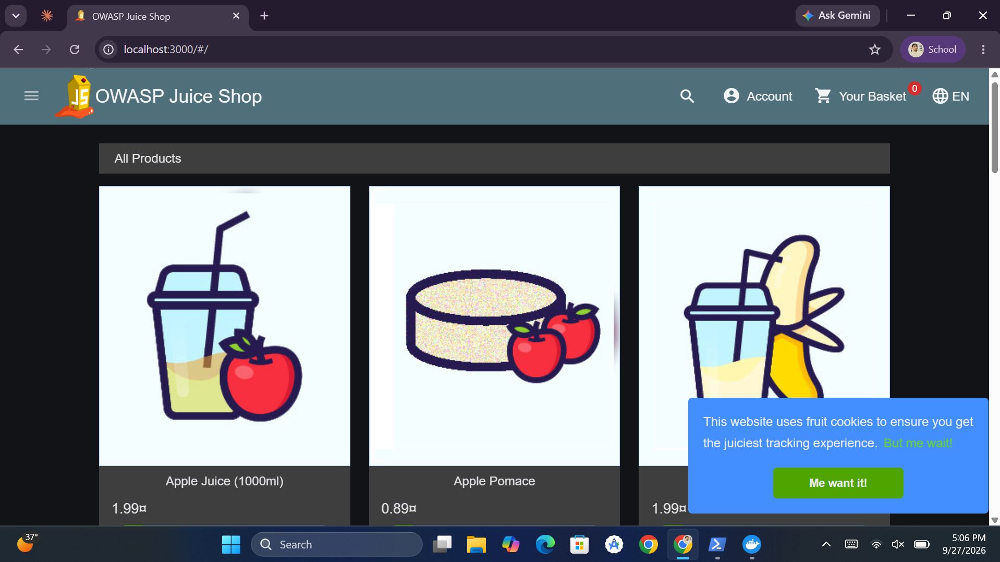
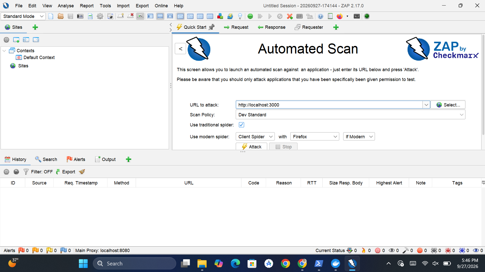
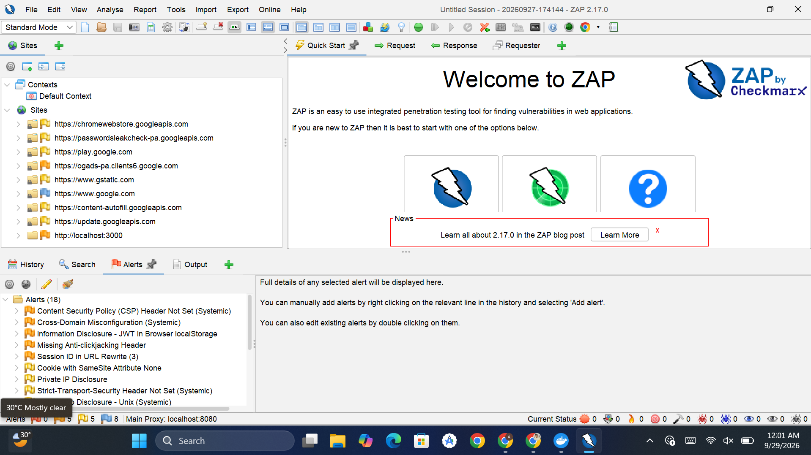
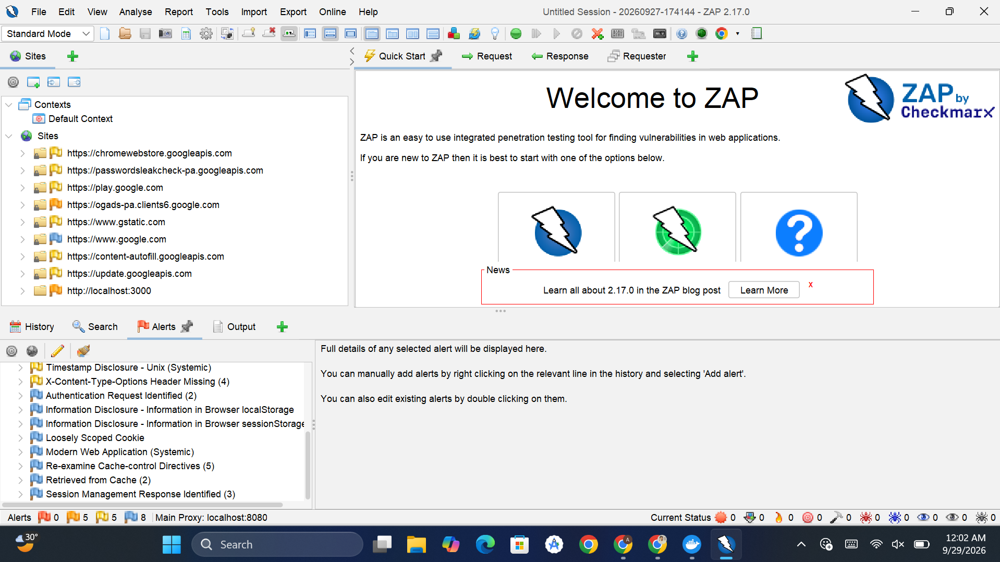
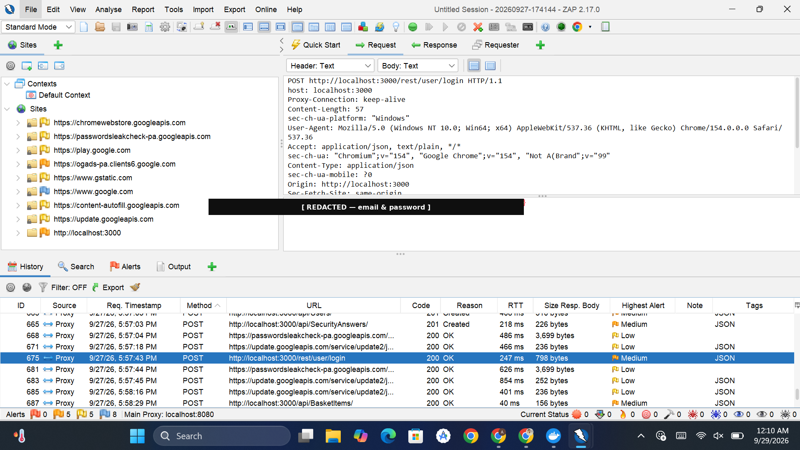
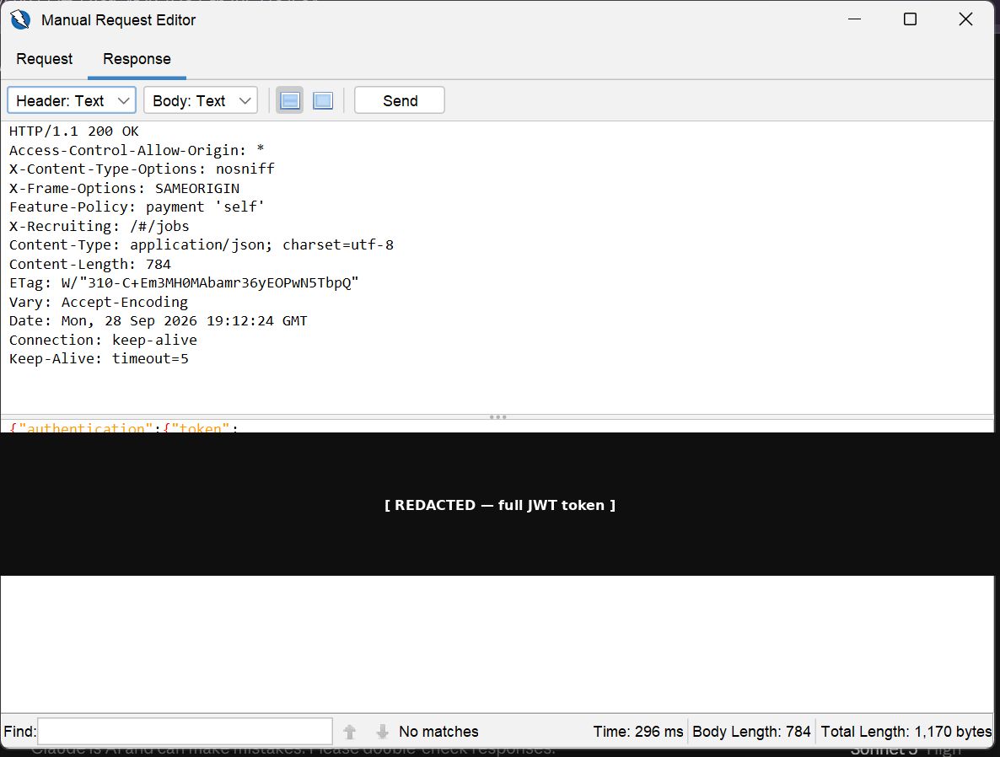
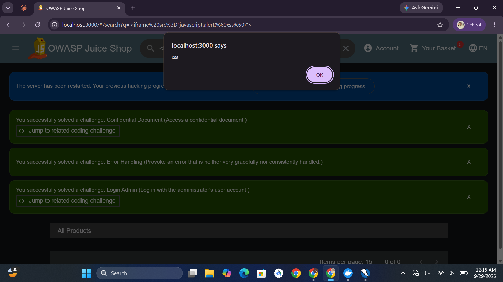
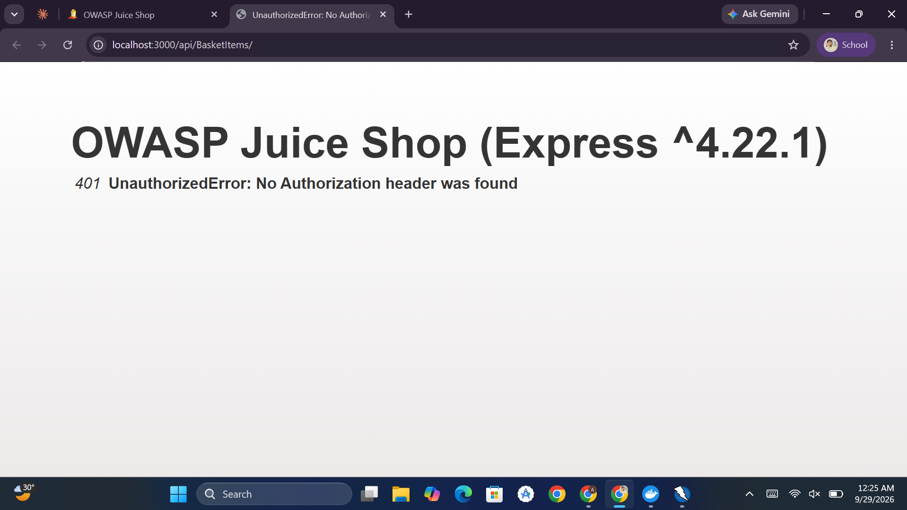
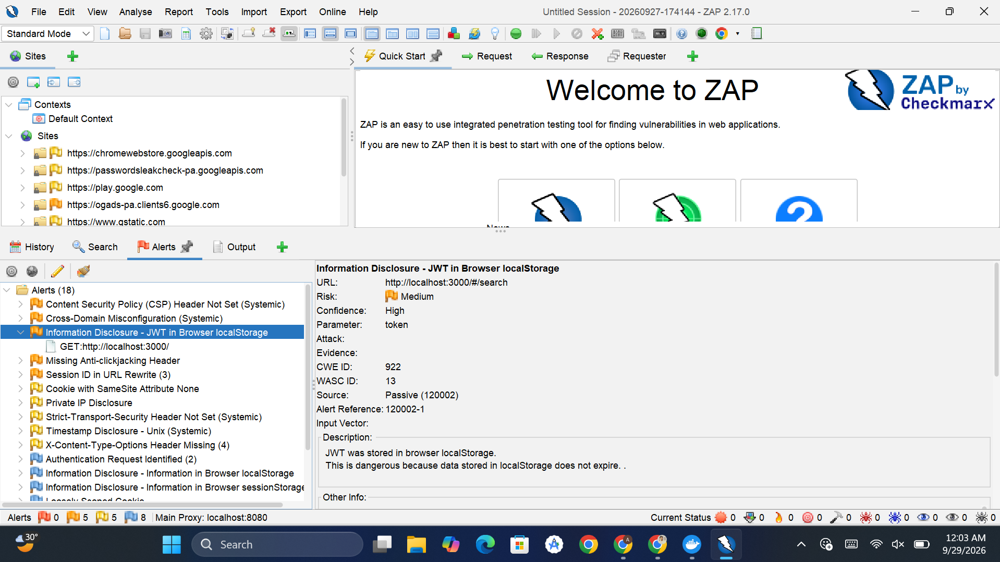
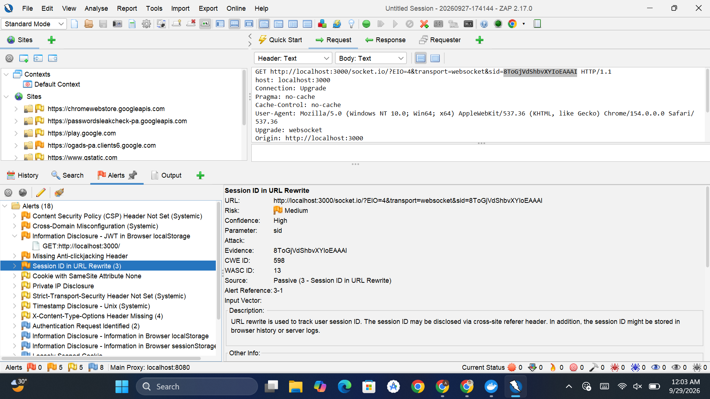

# Web Application Security Audit — OWASP Juice Shop

**Author:** Awais Ali Lashari
**Internship:** Cyber Security Internship, Internee.pk — Task 6
**Date:** September 2026
**Target:** [OWASP Juice Shop](https://owasp.org/www-project-juice-shop/) (locally hosted, `localhost:3000`)
**Tools:** OWASP ZAP 2.17.0

---

## 1. Objective

Identify and validate vulnerabilities in a web application's login pages, user-facing forms, and APIs, focusing on the OWASP Top 10 categories most relevant to this task: **SQL Injection**, **Cross-Site Scripting (XSS)**, and **Cross-Site Request Forgery (CSRF)**.

## 2. Scope & Authorization

Testing was performed against **OWASP Juice Shop**, an intentionally vulnerable web application built by OWASP specifically for security training and practice. It was run locally via Docker (`bkimminich/juice-shop`), so all testing was fully authorized and self-contained — no third-party systems were touched.

> A parallel pass against Internee.pk's staging environment was planned per the task brief but is pending explicit scope/authorization confirmation from internship supervisors, and is not included in this report.



## 3. Methodology

1. **Environment setup** — Juice Shop deployed via Docker; OWASP ZAP installed and configured as an intercepting proxy.
2. **Automated baseline scan** — ZAP's Automated Scan (traditional spider + active scan) run first to establish a baseline and surface configuration-level issues.
3. **Manual exploration** — Since Juice Shop is a JavaScript-heavy Angular SPA, a traditional spider alone under-crawls the application. The app was manually browsed (registration, login, search, basket, account) with the browser proxied through ZAP, so real API traffic was captured for testing.
4. **Active scanning** — A second Active Scan was run against the fuller site map captured during manual exploration.
5. **Manual exploitation** — Specific high-value endpoints (login, search, basket) were manually tested with crafted payloads using ZAP's Request Editor to confirm real exploitability beyond what the automated scanner alone reports.



## 4. Summary of Findings

| # | Finding | Class | Severity | Status |
|---|---|---|---|---|
| 1 | Authentication bypass via SQL Injection | CWE-89 | **Critical** | Confirmed |
| 2 | DOM-based Cross-Site Scripting in search | CWE-79 | **High** | Confirmed |
| 3 | Cross-Site Request Forgery on basket API | CWE-352 | Low (mitigated) | Tested — not exploitable |
| 4 | JWT stored in browser `localStorage` | CWE-922 | Medium | Confirmed |
| 5 | Session identifier exposed in URL (Socket.IO) | CWE-598 | Medium | Confirmed |
| 6 | Missing security headers (CSP, HSTS, X-Content-Type-Options, anti-clickjacking) | CWE-693 | Low | Confirmed |
| 7 | Permissive CORS / cross-domain configuration | — | Medium | Confirmed |

Full alert list from the automated scan (18 total alerts):




---

## 5. Detailed Findings

### 5.1 SQL Injection — Authentication Bypass (Critical)

**Endpoint:** `POST /rest/user/login`
**Parameter:** `email`
**CWE:** CWE-89 (Improper Neutralization of Special Elements in SQL Command)

The login endpoint concatenates user input directly into a SQL query rather than using parameterized queries. Submitting a crafted `email` value comments out the rest of the query's `WHERE` clause, causing the database to return the first matching user record — in this case, the administrator account — without requiring a valid password.

**Baseline (legitimate) request**, for comparison:



**Exploit payload:**
```json
{"email":"' OR 1=1--","password":"x"}
```

**Result:** HTTP 200 OK with a valid JWT authentication token issued for `admin@juice-sh.op` — full authentication bypass with administrative privileges, using no valid credentials.



**Impact:** Complete compromise of any user account, including administrative accounts, without credentials. This is the highest-severity finding in this audit.

**Remediation:**
- Use parameterized queries / prepared statements, or an ORM with proper input binding (e.g., Sequelize with bound parameters) — never build SQL via string concatenation of user input.
- Apply input validation and allow-listing on the `email` field.
- Implement rate limiting and anomaly detection on the login endpoint.

---

### 5.2 DOM-based Cross-Site Scripting (High)

**Endpoint:** Search functionality (`/#/search?q=...`)
**CWE:** CWE-79 (Improper Neutralization of Input During Web Page Generation)

The search feature renders the user-supplied query string into the DOM without adequate sanitization, allowing injected HTML/JavaScript to execute in the victim's browser.

**Payload:**
```html
<iframe src="javascript:alert(`xss`)">
```

**Result:** JavaScript alert executed immediately upon search, confirming arbitrary script execution in the application's origin. Independently corroborated by Juice Shop's own built-in challenge tracker, which flagged the "Login Admin" and related challenges as solved during this testing session.



**Impact:** An attacker could craft a malicious link that, when clicked by a victim, executes arbitrary JavaScript in the context of the application — enabling session token theft (particularly severe here, since the JWT is stored in `localStorage`, see 5.4), credential harvesting via fake forms, or full account takeover.

**Remediation:**
- Sanitize and/or HTML-encode all user-supplied input before rendering it into the DOM.
- Avoid `innerHTML`/`bypassSecurityTrustHtml`-style rendering of untrusted input in Angular; use safe binding methods.
- Implement a strict Content Security Policy (see 5.6) as defense-in-depth.

---

### 5.3 Cross-Site Request Forgery — Tested, Not Exploitable (Positive Finding)

**Endpoint tested:** `POST /api/BasketItems/`
**CWE:** CWE-352 (Cross-Site Request Forgery)

A proof-of-concept HTML page was built to auto-submit a forged cross-origin form to the basket API while authenticated in a legitimate session, simulating a victim visiting a malicious site while logged in.

**Result:** `401 Unauthorized — No Authorization header was found`. The forged request failed.



**Analysis:** Juice Shop authenticates API requests via a Bearer token in the `Authorization` header (issued at login and stored client-side), rather than via an auto-attached session cookie. Browsers do not automatically attach custom headers like `Authorization` to cross-origin form submissions, so this authentication pattern inherently defeats classic CSRF attacks — no explicit anti-CSRF token is even needed for this protection to hold.

**Caveat:** This protection is contingent on the token remaining confidential. Since Finding 5.2 (XSS) and Finding 5.4 (JWT in `localStorage`) together mean a successful XSS attack could read the token directly, an attacker who achieves XSS could still forge authenticated requests — just not via classic cross-site form CSRF. This is noted as a chained-risk observation.

**Recommendation:** Maintain header-based (not cookie-based) authentication. If cookies are ever introduced for session handling, they must be paired with `SameSite=Strict` and explicit anti-CSRF tokens.

---

### 5.4 JWT Stored in Browser `localStorage` (Medium)

**CWE:** CWE-922 (Insecure Storage of Sensitive Information)

The authentication JWT is stored in `localStorage` rather than an `HttpOnly` cookie. Data in `localStorage` does not expire automatically and is readable by any JavaScript running in the page's origin — including injected scripts via XSS (see 5.2).



**Remediation:** Store authentication tokens in `HttpOnly`, `Secure`, `SameSite=Strict` cookies where feasible, which are inaccessible to JavaScript and thus immune to token theft via XSS.

---

### 5.5 Session Identifier Exposed in URL (Medium)

**CWE:** CWE-598 (Information Exposure Through Query Strings in GET Request)

The Socket.IO session identifier (`sid`) is passed as a URL query parameter rather than in a header or cookie, risking exposure via browser history, server access logs, and the `Referer` header.



**Remediation:** Pass session identifiers via headers or cookies rather than URL parameters; scrub sensitive query parameters from logs.

---

### 5.6 Missing Security Headers (Low)

The application does not set several standard hardening headers:
- **Content-Security-Policy** — absent, increasing the impact of any XSS (see 5.2)
- **Strict-Transport-Security** — absent
- **X-Content-Type-Options** — absent
- **Anti-clickjacking header** (`X-Frame-Options` / `frame-ancestors`) — absent

**Remediation:** Set these headers at the application or reverse-proxy layer. A CSP in particular would have reduced the impact of Finding 5.2.

---

### 5.7 Permissive CORS Configuration (Medium)

Cross-domain response headers are configured too permissively, potentially allowing other origins to read responses they should not have access to.

**Remediation:** Restrict `Access-Control-Allow-Origin` to explicitly trusted origins rather than a wildcard or overly broad configuration.

---

## 6. Risk Summary

| Severity | Count |
|---|---|
| Critical | 1 |
| High | 1 |
| Medium | 4 |
| Low | 2 |
| Info / Positive | 1 |

## 7. Conclusion

This audit confirmed two high-impact, directly exploitable vulnerabilities (SQL Injection leading to full authentication bypass, and DOM-based XSS) alongside several medium/low-severity configuration and hardening gaps. One tested attack class (CSRF) was found to be effectively mitigated by the application's authentication architecture, though this protection is contingent on the XSS finding being remediated.

**Priority remediation order:**
1. Fix SQL Injection (5.1) — parameterize all database queries immediately.
2. Fix XSS (5.2) — sanitize rendered user input; this also strengthens the CSRF mitigation's durability.
3. Move JWT storage to `HttpOnly` cookies (5.4).
4. Apply missing security headers (5.6) as defense-in-depth.
5. Address remaining medium/low findings (5.3 caveat, 5.5, 5.7) as time allows.

---

*This assessment was conducted against OWASP Juice Shop, an application intentionally built with known vulnerabilities for security training purposes. Findings and methodology are documented here as part of a Cyber Security internship deliverable.*
